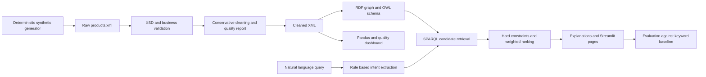

# ShopGlobe

An explainable product discovery demo built with XML, XSD, RDF, OWL concepts, SPARQL, Pandas and Streamlit. **All products, brands, ratings, prices and stock values are synthetic.** No external API, database or account is required.

## Problem and objectives

Literal search can miss products whose attributes satisfy a request without repeating its exact wording. ShopGlobe parses common shopping phrases into a category, required features, intended use, price bounds and RAM. It retrieves candidates through RDF/SPARQL, enforces explicit constraints, ranks eligible products and shows the evidence for each match. The project demonstrates XML validation, conservative cleaning, semantic relationships, interactive discovery, and measured comparison with a literal keyword baseline.

## Technology stack

Python 3.11+, Pandas, NumPy, ElementTree-compatible XML structure parsed safely with lxml, RDFLib, RDFS/OWL vocabularies, SPARQL, Streamlit, Plotly, NetworkX, PyVis, pytest and ipywidgets for Colab. The code uses lxml for XSD validation and secure XML parsing; the XML is also compatible with Python's standard ElementTree data model.

## Architecture



## Data and XML schema

`data/products.xml` has 527 source records across ten categories. Six are rejected; one category label is normalized, leaving 521 usable records in `data/cleaned_products.xml`. The generator uses seed 2408 and produces 52 base products per category, plus seven controlled anomalous records. `data/invalid_samples.xml` preserves the injected anomalies. `data/products.xsd` requires the product structure and checks nonempty names, positive prices, ratings in 0–5 and Boolean stock values. Business validation checks category membership, required IDs and attributes, duplicates and numeric bounds. Missing attributes are rejected; no unknown feature is silently treated as false. The source is preserved unchanged by cleaning. `data/quality_report.json` contains counts, rejected IDs/reasons, missing values and normalization actions.

A product contains ID, name, brand, category, subcategory, description, INR price, rating, stock, feature list, intended activities, specifications and keyed attributes. Footwear explicitly records waterproofing, arch support, stability support and activity. Electronics include RAM, storage and battery specifications where applicable. A missing property never becomes a positive match.

## Ontology and knowledge graph

`ontology/shopglobe.owl` declares classes including `Product`, `Footwear`, `RunningShoes`, `Electronics`, `Smartphone`, `Laptop`, `Feature`, `Brand`, `Category` and `Activity`. It declares `RunningShoes rdfs:subClassOf Footwear`, related concepts such as `StabilitySupport` ↔ `FlatFeetSupport`, and properties such as `belongsToCategory`, `hasFeature`, `manufacturedBy`, `suitableForActivity`, `hasSupportType`, `hasWaterResistance` and `hasPrice`. `ontology/products.ttl` and `ontology/products.rdf` serialize product triples. RDFLib executes SPARQL for candidate IDs. **RDFLib does not provide full OWL reasoning here.** Equivalent and related phrases are expanded explicitly by query rules, and matches are checked against stored product attributes.

## Search and ranking

The parser normalizes whitespace and case, recognizes rupee values including `k` and `lakh`, RAM in GB, category synonyms, features, intended activity and simple negation. Price and RAM bounds, category, subcategory, explicit features and specified activity are hard filters. A gaming laptop also needs an explicit dedicated-graphics attribute. The graph supplies candidate IDs by category and price; the recommendation engine checks the other constraints. For a positive feature, evidence must be a listed feature, a true attribute, or an explicitly documented rule such as battery capacity ≥ 5000 mAh for “good battery.” Unknown information is not counted as a match.

Active ranking factors are category 25%, features 35%, intended use 20%, specifications 15% and rating 5%. When a factor is not requested, its weight is removed and the remaining weights are normalized to 100%. Required factors are already satisfied by eligible products, so rating often breaks ties. Explanations identify exact, attribute-backed and semantically inferred evidence.

This is a catalog-specific rule parser. It does not understand arbitrary language, comparative claims, or medical suitability beyond the stated support attribute. “Flat feet” means an explicit stability-support property in this demo, not a clinical fit guarantee.

## Install and run

```bash
python -m venv .venv
# Windows: .venv\Scripts\activate
# macOS/Linux: source .venv/bin/activate
python -m pip install -r requirements.txt
python scripts/initialize_project.py
python -m pytest tests -q
streamlit run app.py
```

The generated XML, reports and RDF files are included, so `streamlit run app.py` also works after installing dependencies without regeneration. Run initialization whenever generator or ontology code changes. The app resolves files relative to `app.py`, not the launch directory.

## Six application pages

Home has search, categories, featured products and catalog statistics. Intelligent Product Search has natural-language input, filters, sorting, product cards and explanations. Product Comparison compares 2–4 records and optional query relevance. Semantic Knowledge Graph displays a focused PyVis product neighborhood with labeled relationships. Data Quality Dashboard shows rejected records and Plotly summaries. Search Evaluation measures the keyword baseline against semantic search and shows side-by-side results.

## Evaluation methodology

`data/evaluation_queries.json` holds 30 fixed, manually reviewed query/ID judgment lists based on attributes in the synthetic catalog. The lists were initially seeded from semantic candidates and then inspected, so they are **not an independent benchmark** and may favor ShopGlobe. Each list contains three known relevant examples, not every relevant product. The dashboard measures precision@K as relevant returned / K and recall@K as relevant returned / listed relevant IDs; it also times each query with `time.perf_counter`. Results are computed at runtime, not prewritten. The literal baseline token-matches catalog text and intentionally has no semantic or price interpretation. Timing varies with machine and graph cache state.

## Google Colab

Open `notebooks/ShopGlobe_Colab_Demo.ipynb` in Colab and run all cells. The notebook bundles the project source and schema in a small compressed payload, installs its dependencies, generates the synthetic XML and RDF locally in `/content/ShopGlobe`, validates and cleans records, executes SPARQL, offers an ipywidgets search box, draws a focused graph and measures the two search methods. It does not use a public tunnel. The notebook is self-contained; no GitHub repository URL is needed.

## Streamlit Community Cloud deployment

The app is live at [shopglobe-2pdfp9ac6xngnqzggpjfht.streamlit.app](https://shopglobe-2pdfp9ac6xngnqzggpjfht.streamlit.app/). Its public source repository is [anitej299/ShopGlobe](https://github.com/anitej299/ShopGlobe) on branch `main`. Streamlit Community Cloud deploys `app.py` and installs the root `requirements.txt`; no app secrets or database are needed.

## Screenshots

Screenshots are intentionally omitted because no hosted or browser-captured run is bundled. Capture the six pages after launching the app if screenshots are needed for a report.

## Limitations and future work

The dataset is synthetic, ratings and stock are illustrative, synonym coverage is finite, and evaluation labels are small and candidate-seeded. Future work could add independent blind judgments, richer unit parsing, uncertainty-aware feature matching, a compatible OWL reasoner, product images, real catalog ingestion with provenance and accessibility testing. Optional sentence-transformer similarity could be added as a secondary ranking signal; core behavior deliberately stays lightweight and offline.
